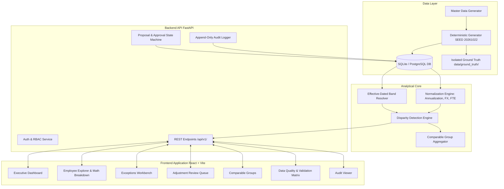
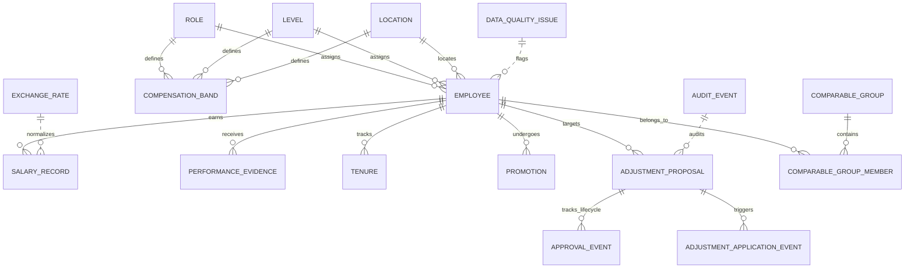
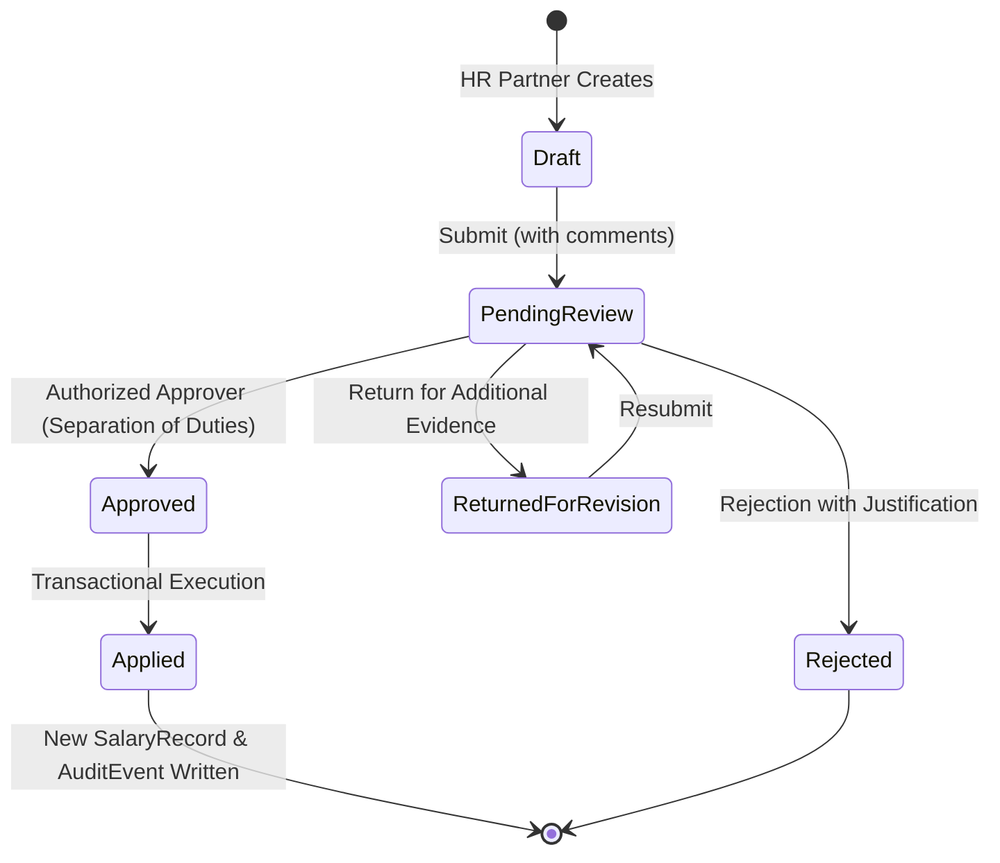

# System Architecture & Technical Design

## 1. Executive Summary

The **Compensation Disparity Analysis and Explainable Pay Equity Review System** (PayEquix) is an enterprise analytics platform designed to detect unexplained compensation disparities, identify data-quality exceptions, and provide human-in-the-loop workflow governance for HR compensation adjustments.

The platform separates **Data-Quality Exceptions** (records that cannot be evaluated reliably due to missing or invalid inputs) from **Compensation Review Candidates** (statistically anomalous salaries requiring evidence-based human review). Furthermore, protected attributes are never utilized in individual pay decisions or feature sets.

---

## 2. System Architecture Diagram

---

## 3. Entity-Relationship Diagram (ERD)

---

## 4. Ground-Truth Isolation Architecture

Ground-truth files (`data/ground_truth/ground_truth.csv` and `ground_truth.json`) are generated by an isolated scenario injection layer executed **after** valid baseline records are established.

1. **Isolation Boundary**: The production backend analytical engine (`DisparityAnalysisEngine`) and API endpoints have zero code references to `ground_truth.json`.
2. **Feature Shielding**: Analytical inputs rely exclusively on standard transactional tables (`employees`, `salary_records`, `compensation_bands`, `exchange_rates`).
3. **Restricted Evaluation Access**: Ground-truth comparisons are restricted to standalone evaluation pipelines (`calculate_metrics.py`) and the system administrator role.

---

## 5. Human-in-the-Loop Proposal State Machine

### Separation of Duties Policy
The proposal creator (`created_by`) is strictly prohibited by server-side logic from self-approving their own proposal. An explicit `HTTP 403 Forbidden` response is returned if the creator attempts approval, ensuring dual-custody governance.
